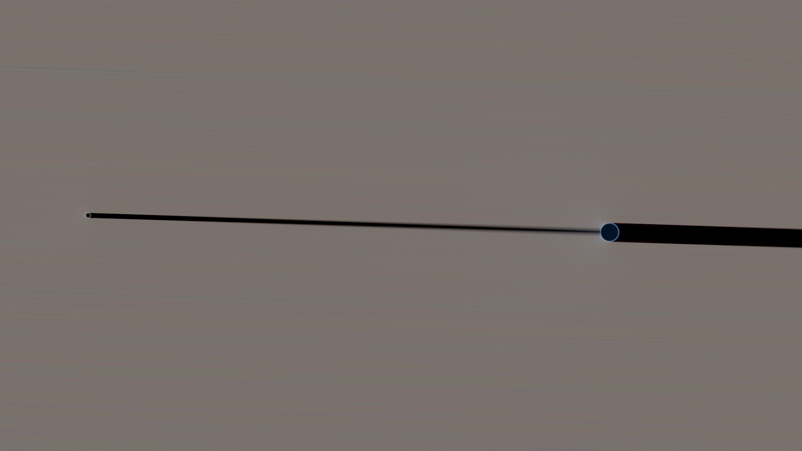
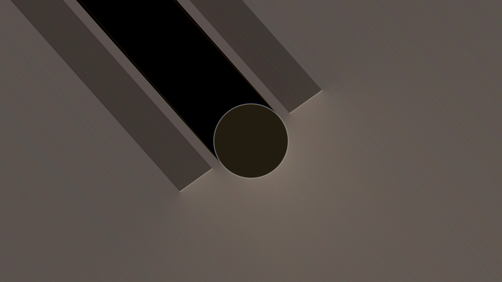
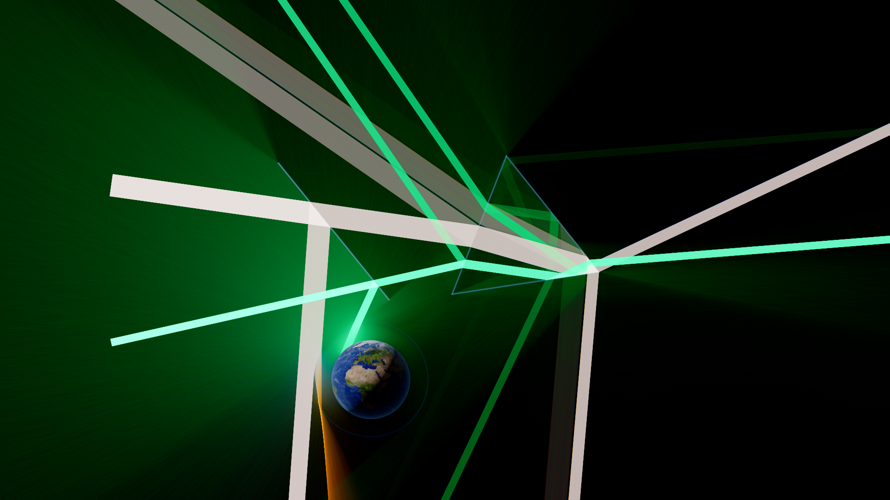

# caustic

GPU-accelerated photon playground and general-relativistic physics studio in pure safe Rust, unifying a true-ratio NASA Solar System photon simulator, a verified 3D rotating Kerr black hole tracer, an interactive multi-emitter optical sandbox, and continuous graded-index (GRIN) optics.








## Overview

`caustic` is a modular GPU physics engine built on `wgpu` (Vulkan) and WGSL compute shaders with zero `unsafe` code. Launching `caustic` opens a unified dark-glass interactive studio where every named mode sits one click away in a minimal floating pill bar (`H` or `Tab` hides all UI for a full-bleed canvas):

* **caustic-core**: Shared Vulkan/WGSL GPU context, timestamp profiling, CIE 1931 2-degree spectral/blackbody LUTs, and Troy Sobotka AgX Punchy presentation pass.
* **caustic-blackhole**: Backward-traced 3D rotating Kerr black hole renderer verified against an independent Boyer-Lindquist CPU `f64` oracle.
* **caustic-photons**: Real-time forward-in-time spectral (`380..780 nm`) photon engine supporting a true-ratio `f64` Keplerian Solar System, multi-emitter optical sandboxes, continuous GRIN eikonal fields, and curved equatorial Ingoing Kerr-Schild spacetime.
* **caustic-app**: Unified minimal `egui` studio and headless CLI for rendering, benchmarking, and physics verification.

## Features

* **True-ratio Solar System with KSP/KSA scale toggle**: Models the Sun, Mercury, Venus, Earth, Moon, Mars, Jupiter, Io, Europa, ringed Saturn (`1.28-2.35 R`), Uranus, and Neptune using exact NASA radii, J2000 mean semi-major axes, eccentricities, Kepler's Third Law periods, and Bond albedos, with a `1:1 Real` / `1:10 (KSP/KSA)` toggle that preserves every ratio identically.
* **Floating-origin camera & frustum-sampled sunlight**: Computes camera-relative `f64` coordinates before GPU upload and switches automatically to frustum importance-sampled finite-angular-disk `5778 K` sunlight (`0.533 deg` at Earth, `0.056 deg` at Saturn, `0.018 deg` at Neptune), enabling seamless zoom across more than six orders of magnitude (`90 AU` down to `7,500 km`) with true total/annular solar eclipses, Rayleigh-refracted lunar eclipses, Saturn ring shadows, and Io transits.
* **KSP/KSA map view & staged astronomical events**: Draws live Keplerian orbit ellipses, clickable body reticles, logarithmic time warp (`1x` to `30d/s`), live telemetry (view height, Sun distance, solar angular diameter, and light-travel delay), and one-click presets for `Lunar Eclipse`, `Solar Eclipse`, `Saturn Rings`, and `Io Transit`.
* **Multi-emitter physical light sources**: Combine up to 16 simultaneous emitters (`Beam`, `Point`, `Spotlight`, `Star Disk`) with equal-energy white, true Planck blackbody temperatures (`2000-15000 K`), or monochromatic lasers (`400-700 nm`).
* **Interactive photon sandbox & real glass catalog**: Click to move, `Shift+drag` to rotate, add (`Prism`, `Lens`, `Mirror`, `Arc`, `Beam Splitter`, `Matte Wall`, `Planet`, `Stop`), or delete elements live using published refractive dispersion (`Water`, `BK7 Glass`, `SF11 Flint`, `Diamond`, plus studio `High-Disp`), exact unpolarized Fresnel reflection/refraction, TIR, and Lambertian albedo scattering.
* **Continuous GRIN eikonal optics**: Integrates Fermat's eikonal Hamiltonian `H = 1/2 (|p|^2 - n(x, lambda)^2) = 0` via RK4 across an aberration-free **Luneburg Lens**, a chromatic inverse-square **Optical Black Hole**, and a **Thermal Mirage** caustic.
* **Exact rotating Kerr geodesics (3D & 2D)**: Traces 3D Outgoing Kerr-Schild geodesics with a Page-Thorne (1974) accretion disk and 2D forward Ingoing Kerr-Schild photon wavefronts with Shapiro delay and frame-dragging asymmetry across `a in [-0.998, +0.998]`.
* **High-FPS stochastic strided spectral splatting**: Accumulates strictly non-negative fixed-point CIE 1931 XYZ with unbiased strided arc-length splatting, smooth temporal EMA for animated orbits, and automatic idle convergence.
* **Independent verification**: Tests GPU black hole outputs against a CPU `f64` Boyer-Lindquist DOPRI5 oracle, alongside unit tests for NASA radii/Kepler's Third Law/eclipse geometry, Fresnel/prism refraction, Planck/Rayleigh physics, GRIN lensing, and headless `lavapipe` determinism.
* **Pure safe Rust**: Compiles with `unsafe_code = "forbid"`, embedded WGSL shaders, and no C/C++ build toolchain.

## Installation

### Requirements

* Rust `1.100` or newer (edition 2024)
* GNU Make
* A Vulkan 1.2+ driver (NVIDIA, AMD, Intel, or Mesa `lavapipe` for software headless verification)

### Build

```sh
git clone https://github.com/grunclepug/caustic
cd caustic
make build
sudo make install
```

## Usage

### Unified Interactive Studio

Launch the unified studio (all 11 named modes accessible from the top floating pill bar):

```sh
caustic
caustic photons view --scene solar-system --solar-focus solar-eclipse
caustic photons view --scene solar-system --solar-focus inner --solar-scale ksp
caustic photons view --scene sandbox
caustic view --spin 0.95 --radius 22 --inclination 82
```

Built-in named modes:

* **3D Relativity**: `Kerr Black Hole` (`0`)
* **Optical Playground & Solar System**: `Dispersive Prism` (`1`), `Nephroid Cavity` (`2`), `Chromatic Lens` (`3`), `Solar System` (`4`), `Photon Sandbox` (`5`)
* **GRIN Optics**: `Luneburg Lens` (`6`), `Optical Black Hole` (`7`), `Thermal Mirage` (`8`)
* **2D Relativity**: `Kerr Lensing Beam` (`9`), `Kerr Pulsar`

### Headless Rendering, Benchmarks & Verification

```sh
caustic photons render --scene solar-system --solar-focus solar-eclipse --frames 120 --output solar-eclipse.png
caustic photons render --scene solar-system --solar-focus lunar-eclipse --frames 120 --output lunar-eclipse.png
caustic photons render --scene solar-system --solar-focus saturn --frames 120 --output saturn.png
caustic photons render --scene solar-system --solar-focus io-transit --frames 120 --output io-transit.png
caustic photons render --scene solar-system --solar-focus solar-eclipse --mode pulse --frames 72 --output solar-pulse.png
caustic photons bench --scene solar-system --solar-focus lunar-eclipse --width 1920 --height 1080

caustic render --spin 0.998 --radius 20 --inclination 82 --output kerr.png
caustic bench --spin 0.998
caustic verify --width 512 --height 512
```

### Interactive controls

| Key / Input | Action |
| --- | --- |
| `0` / `1`-`9` | Switch named mode (`0` = Kerr Black Hole 3D, `1`-`9` = forward photon presets) |
| `H` / `Tab` | Toggle minimal floating HUD visibility |
| `P` | Pause / resume orbital clock in Solar System mode |
| Left click / drag | Focus clicked body or pan (Solar System), orbit (3D Black Hole), or drag emitter / optical element |
| `Shift` + Left drag | Rotate selected optical element |
| Right drag | Aim active photon emitter beam angle |
| Scroll wheel | Seamless zoom across 6+ orders of magnitude (Solar System) or adjust camera field of view |
| `M` | Toggle Steady accumulation vs Wavefront pulse mode |
| `Space` | Fire synchronized photon wavefront pulse (Wavefront mode) |
| `[` / `]` | Halve / double Solar System time warp, or decrease / increase Kerr spin `a` / dispersion scale |
| `Q` / `E` | Rotate selected object or emitter angle |
| `Delete` / `Backspace` | Delete selected object or extra emitter |
| `-` / `=` | Decrease / increase exposure |
| `S` | Save full-resolution PNG screenshot |
| `R` | Reset current mode |
| `Esc` | Quit |

### Configuration (Forward Photons, Solar System & GRIN)

| Flag | Default | Description |
| --- | --- | --- |
| `--scene` | `prism` | Preset: `prism`, `cardioid`, `lens`, `solar-system`, `sandbox`, `luneburg`, `optical-bh`, `mirage`, `kerr-beam`, `kerr-pulsar` |
| `--solar-focus` | `lunar-eclipse` | Solar System focus or event: `lunar-eclipse`, `solar-eclipse`, `saturn`, `io-transit`, `system`, `inner`, `sun`, `mercury`, `venus`, `earth`, `moon`, `mars`, `jupiter`, `io`, `uranus`, `neptune` |
| `--solar-scale` | `real` | Solar System linear scale: `real` (`1:1` NASA) or `ksp` (`1:10` KSP/KSA, identical ratios) |
| `--mode` | `accumulate` | Transport mode: `accumulate` (Steady) or `pulse` (Wavefront) |
| `--photons` | `1000000` | Photon pool size (persistent count in Wavefront; scaled per-frame batch in Steady) |
| `--substeps` | `4` | Integration substeps per frame in Wavefront mode |
| `--spin` | `0.95` | Kerr black hole spin `a` in `[-0.998, +0.998]` |
| `--dispersion` | preset | Dispersion multiplier (`0.0` = achromatic) |
| `--strength` | `1.0` | GRIN refractive field strength multiplier |
| `--exposure` | `1.0` | Radiance exposure multiplier |
| `--seed` | `42` | Deterministic PRNG seed |
| `--software` | `false` | Force software Vulkan adapter (`lavapipe`) |

## Development

```sh
make run
make test
make lint
make fmt
make build
make bench
make photons-bench
make render
make clean
```

## Contributing

Fork the repository and open a pull request.

## License

MIT. See [LICENSE](LICENSE).

## Author

Chad Humphries | [Website](https://grunclepug.com/) | [GitHub](https://github.com/GrunclePug) | [More projects](https://github.com/GrunclePug?tab=repositories)
