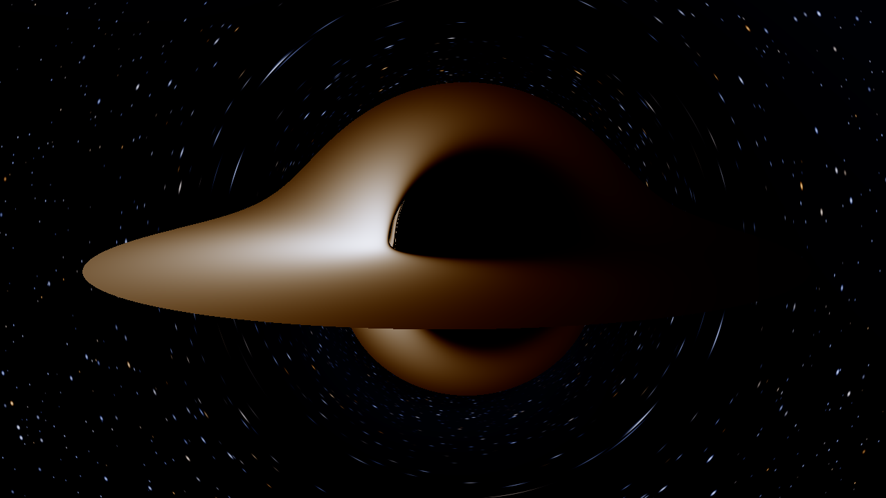
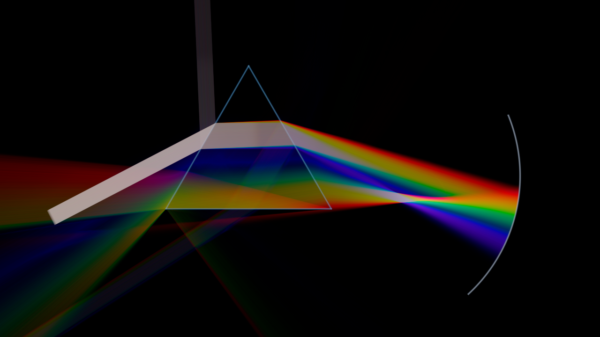
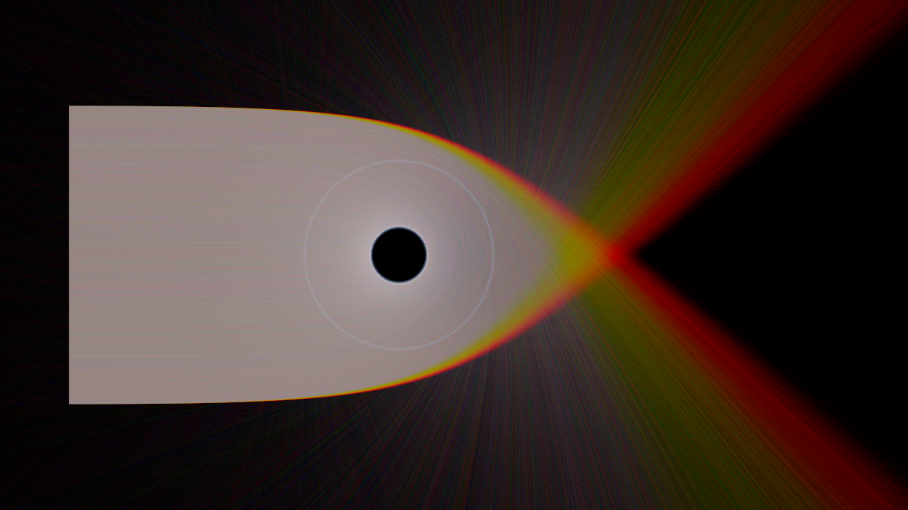
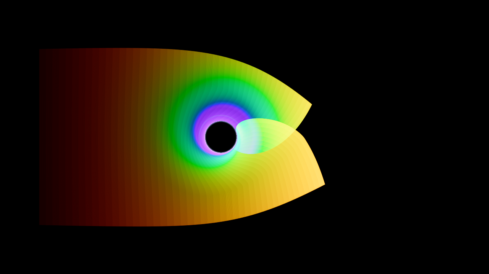

# caustic

GPU-accelerated physics simulation studio in pure safe Rust, unifying a verified 3D rotating Kerr black hole tracer, an interactive dispersive optical bench, continuous graded-index (GRIN) optics, and relativistic forward photon transport.









## Overview

`caustic` is a modular GPU physics engine built on `wgpu` (Vulkan) and WGSL compute shaders with zero `unsafe` code. Launching `caustic` opens a unified dark-glass interactive studio where every simulation mode sits one click away in a minimal floating pill bar (`H` or `Tab` hides all UI for pure full-bleed visuals):

* **caustic-core**: Shared Vulkan/WGSL GPU context, timestamp profiling, CIE 1931 2-degree spectral/blackbody LUTs, and Troy Sobotka AgX Punchy presentation pass.
* **caustic-blackhole**: Backward-traced 3D rotating Kerr black hole renderer verified against an independent Boyer-Lindquist CPU `f64` oracle.
* **caustic-photons**: Real-time forward-in-time spectral (`380..780 nm`) photon engine covering editable dispersive optics, continuous GRIN eikonal fields, and curved equatorial Ingoing Kerr-Schild spacetime.
* **caustic-app**: Unified minimal `egui` studio and headless CLI for rendering, benchmarking, and physics verification.

## Features

* **Exact rotating Kerr geodesics (3D)**: Integrates future-directed null 4-momentum backward in Outgoing Cartesian Kerr-Schild coordinates with classical RK4, covariant ZAMO camera tetrads, and a relativistic Page-Thorne (1974) accretion disk across `a in [-0.998, +0.998]`.
* **Interactive optical bench & real glass materials**: Click to drag, `Shift+drag` to rotate, add (`Prism`, `Lens`, `Mirror`, `Arc`, `Beam Stop`), or delete elements live on the canvas with real dispersive Cauchy media (`Water`, `Crown BK7`, `Flint SF11`, `Dense Flint`, `Diamond`), exact unpolarized Fresnel reflection/refraction, and TIR.
* **Continuous GRIN eikonal optics**: Integrates Fermat's eikonal Hamiltonian `H = 1/2 (|p|^2 - n(x, lambda)^2) = 0` via RK4 to simulate an aberration-free **Luneburg Lens**, a chromatic inverse-square **Optical Black Hole** (where violet is captured while red escapes), and a **Thermal Mirage** caustic.
* **Curved-spacetime forward photon flight**: Propagates 1M+ physical photon packets in equatorial Ingoing Cartesian Kerr-Schild coordinates with gravitational blueshift/redshift, Shapiro coordinate-time delay, frame-dragging asymmetry, and swallowtail wavefront caustics.
* **High-FPS stochastic strided spectral splatting**: Accumulates strictly non-negative fixed-point CIE 1931 XYZ with unbiased strided arc-length splatting, adaptive drag/settle budgets, and automatic idle convergence once settled.
* **Independent cross-formulation verification**: Verifies GPU FP32 black hole outputs against a CPU `f64` inverse-radius Boyer-Lindquist DOPRI5 oracle, alongside exact analytical unit tests for Fresnel/prism optics, Luneburg rim focus, optical black hole deflection, thermal mirage invariants, and headless `lavapipe` determinism.
* **Pure safe Rust**: Compiles with `unsafe_code = "forbid"`, embedded WGSL shaders, and no C/C++ build toolchain.

## Installation

### Requirements

* Rust `1.100` or newer (edition 2024)
* GNU Make
* A Vulkan 1.2+ driver (NVIDIA, AMD, Intel, or Mesa `lavapipe` for software headless verification)

### Build

```sh
git clone https://github.com/grunclepug/caustic
cd caustic
make build
sudo make install
```

## Usage

### Unified Interactive Studio

Launch the unified studio (all 9 named modes accessible from the top floating pill bar):

```sh
caustic
caustic view --spin 0.95 --radius 22 --inclination 82
caustic photons view --scene prism
caustic photons view --scene optical-bh --mode pulse
```

Built-in named modes:

* **3D Relativity**: `Kerr Black Hole` (`0`)
* **Optical Bench**: `Dispersive Prism` (`1`), `Nephroid Cavity` (`2`), `Chromatic Lens` (`3`)
* **GRIN Optics**: `Luneburg Lens` (`4`), `Optical Black Hole` (`5`), `Thermal Mirage` (`6`)
* **2D Relativity**: `Kerr Lensing Beam` (`7`), `Kerr Pulsar` (`8`)

### Headless Rendering, Benchmarks & Verification

```sh
caustic render --spin 0.998 --radius 20 --inclination 82 --output kerr.png
caustic bench --spin 0.998
caustic verify --width 512 --height 512

caustic photons render --scene prism --frames 40 --output prism.png
caustic photons render --scene optical-bh --frames 40 --output optical-bh.png
caustic photons render --scene kerr-beam --mode pulse --frames 46 --output kerr-pulse.png
caustic photons bench --scene prism --width 1920 --height 1080
```

### Interactive controls

| Key / Input | Action |
| --- | --- |
| `0` / `1`-`8` | Switch named mode (`0` = Kerr Black Hole 3D, `1`-`8` = forward photon presets) |
| `H` / `Tab` | Toggle minimal floating HUD visibility |
| Left drag | Orbit camera (3D Black Hole), drag selected optical element, or move photon emitter |
| `Shift` + Left drag | Rotate selected optical element |
| Right drag | Aim photon emitter beam angle |
| Scroll wheel | Zoom camera distance or 2D field of view |
| `M` | Toggle Steady accumulation vs Wavefront pulse mode |
| `Space` | Fire synchronized photon wavefront pulse (Wavefront mode) |
| `[` / `]` | Decrease / increase Kerr spin `a` or dispersion scale |
| `Q` / `E` | Rotate selected optical element or emitter angle |
| `Delete` / `Backspace` | Delete selected optical element |
| `-` / `=` | Decrease / increase exposure |
| `S` | Save full-resolution PNG screenshot |
| `R` | Reset current mode |
| `Esc` | Quit |

### Configuration (Forward Photons & GRIN)

| Flag | Default | Description |
| --- | --- | --- |
| `--scene` | `prism` | Preset: `prism`, `cardioid`, `lens`, `luneburg`, `optical-bh`, `mirage`, `kerr-beam`, `kerr-pulsar` |
| `--mode` | `accumulate` | Transport mode: `accumulate` (Steady) or `pulse` (Wavefront) |
| `--photons` | `1000000` | Photon pool size (persistent count in Wavefront; scaled per-frame batch in Steady) |
| `--substeps` | `4` | Integration substeps per frame in Wavefront mode |
| `--spin` | `0.95` | Kerr black hole spin `a` in `[-0.998, +0.998]` |
| `--dispersion` | preset | Dispersion multiplier (`0.0` = achromatic) |
| `--strength` | `1.0` | GRIN refractive field strength multiplier |
| `--exposure` | `1.0` | Radiance exposure multiplier |
| `--seed` | `42` | Deterministic PRNG seed |
| `--software` | `false` | Force software Vulkan adapter (`lavapipe`) |

## Development

```sh
make run
make test
make lint
make fmt
make build
make bench
make photons-bench
make render
make clean
```

## Contributing

Fork the repository and open a pull request.

## License

MIT. See [LICENSE](LICENSE).

## Author

Chad Humphries | [Website](https://grunclepug.com/) | [GitHub](https://github.com/GrunclePug) | [More projects](https://github.com/GrunclePug?tab=repositories)
